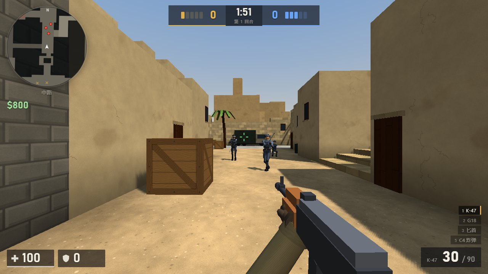
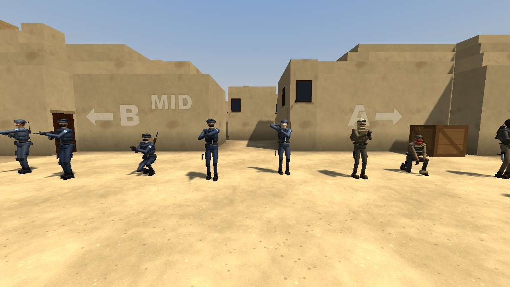
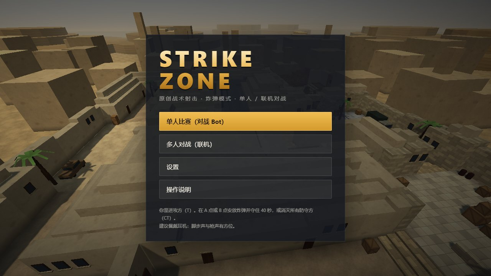

# Strike Zone

> An original browser tactical FPS in the style of Counter-Strike — bomb defusal, bots with real tactics, and online multiplayer.
> The whole client is a single HTML file built with Three.js and vanilla JS. Every model, texture and sound is generated in code; the project ships no external assets.

原创网页战术 FPS（CS 风格），炸弹模式。可以单人对战 Bot，也可以**联机多人**（最多 10 名真人一局，空位由 Bot 补齐）。
**Three.js（cdnjs）+ 原生 JS，客户端是单个 HTML 文件，没有任何外部图片、模型或音频文件。**

**在线试玩：<https://strike.predix.icu>**



| 人物 | 主菜单 |
|---|---|
|  |  |

## 运行

- **单人**：直接双击打开 `strike-zone.html`（Chrome / Edge 最佳，Firefox 也可以）。首次加载需要联网，从 cdnjs 获取 Three.js r128；
  如果 cdnjs 无法访问，会改为加载同目录下的 `three.min.js`（线上服务器已放好这个文件）。其余内容全部内置。
- **联机**：主菜单点"多人对战（联机）"→ 输入昵称 → 创建房间或加入房间。默认连接作者的服务器 `wss://strike.predix.icu/ws`，
  也可以用 `?server=wss://你的域名/ws` 连接自己部署的服务器（见下文"部署自己的服务器"）。

## 多人对战

- **创建房间**：可以选择阵营（自动 / T / CT）、获胜回合（5 / 8 / 13）、Bot 难度，以及 Bot 补位方式：
  "补满 5v5"时每队用 Bot 补到 5 人；"只补齐双方人数差"时 Bot 只补人数少的一方（两人就是 1v1 单挑）。
- **加入房间**：在房间列表里点"加入"，或者输入 4 位房间号。
- **邀请朋友**：进入房间后地址栏会变成 `…/?room=ABCD`，把这个链接发给朋友，对方打开后会自动进入大厅并填好房间号。
- 在冻结时间内加入会立即出生（顶替一个本队 Bot）；回合进行中加入则先观战，下一回合出生。
- 比赛结束后显示战绩，15 秒后房间内自动开始下一场。最后一名真人离开 30 秒后房间关闭。

| 联机按键 | 功能 |
|---|---|
| Y | 全体聊天 |
| U | 队伍聊天 |
| M | 换队（下一回合生效；每队最多 5 名真人） |
| Tab | 计分板（包含每个人的延迟） |
| Esc | 菜单（联机时游戏不会暂停），可以离开房间 |

### 联机架构

```
浏览器（strike-zone.html）            服务器（Node.js，server/）
┌────────────────────────┐   wss    ┌──────────────────────────────────────────┐
│ 19_net.js NetClient     │ ◄──────► │ server.js：WebSocket 大厅、房间列表、消息路由 │
│  · 本地模拟自己的移动    │  JSON    │   └─ 每个房间一个 worker 线程：room.js       │
│  · 上报状态 / 开枪 / 命中 │          │       = 游戏模拟模块（地图/物理/导航/武器/    │
│  · 其他人按快照插值显示   │          │         角色/投掷物/炸弹/Bot/经济/回合）      │
│  · 服务器事件 → 本地事件  │          │       + srv_room.js（真人代理、校验、快照）  │
└────────────────────────┘          └──────────────────────────────────────────┘
```

- **同一套代码**：`build.js` 把 src/ 中与渲染、界面无关的模拟模块，和 `server/src/srv_head.js`、`srv_room.js` 拼成 `server/room.js`。
  服务器运行的回合、经济、Bot AI、炸弹与投掷物逻辑和单人模式完全相同。代码通过 `NET.mode`（`sp` / `client` / `server`）区分运行环境。
- **权威划分**：
  - 客户端负责自己的移动、视角和命中判定（favor the shooter，延迟高时依然"指哪打哪"）。
  - 服务器负责伤害结算、回合、经济、购买、炸弹、投掷物、掉落物，以及所有 Bot。
- **服务器校验**：
  - 移动速度与瞬移检测（超限时把玩家拉回，冻结时间只能原地转身）。
  - 命中请求：武器必须持有，射速用令牌桶限制，还要检查距离，以及目标在最近 0.45 秒内是否可见（考虑延迟）。伤害由服务器按武器数据计算。
  - 购买：区域和时间都在服务器检查。
- **同步频率**：服务器模拟 60Hz，快照 30Hz（位置、姿态、手持武器、队伍"发现"标记用于雷达）；客户端上报 30Hz；其他角色延迟 100ms 插值显示。
- **表现复用**：开枪、爆炸、击杀、下包等服务器事件在客户端重放成本地事件，所以枪声、曳光、弹孔、击杀栏、音效都沿用单人模式的代码。

### 本地运行服务器

```bash
cd server
npm install            # 依赖：ws、three（0.128.0，与客户端同版本）
node server.js         # 默认 127.0.0.1:8795，路径 /ws；健康检查 http://127.0.0.1:8795/ws/health
```

浏览器打开 `strike-zone.html?server=ws://127.0.0.1:8795/ws` 即可连接本地服务器。
环境变量：`PORT`、`HOST`、`MAX_ROOMS`（默认 6），每房间最多 10 名真人，服务器最多 100 个连接。
`SZ_DEBUG=1` 会开启测试用的调试命令（传送、改比分），生产环境不要设置。

### 部署自己的服务器

1. **静态页面**：把 `strike-zone.html`（可改名为 `index.html`）放到任意静态网站上。建议同时放一份 Three.js r128 的 `three.min.js`，
   在 cdnjs 访问不了时作为回退。它在 `server/node_modules/three/build/three.min.js`，执行 `npm install` 后才会出现。
2. **游戏服务器**：把 `server/` 目录（`server.js`、`room.js`、`package.json`、`package-lock.json`）复制到服务器，
   然后执行 `npm ci --omit=dev`，再用 `node server.js` 启动（默认只监听 `127.0.0.1:8795`）。
   建议用 systemd 或 pm2 常驻，示例：

   ```ini
   [Service]
   WorkingDirectory=/opt/strike-zone
   Environment=PORT=8795
   ExecStart=/usr/bin/node server.js
   Restart=on-failure
   ```
3. **反向代理**：页面和 WebSocket 放在同一个域名下，用 HTTPS 访问，以 Caddy 为例：

   ```
   game.example.com {
       handle /ws* {
           reverse_proxy 127.0.0.1:8795
       }
       handle {
           root * /var/www/strike
           file_server
       }
   }
   ```
4. **修改默认服务器**：把 `src/00_config.js` 里的 `CFG.NETCFG.URL` 改成 `wss://game.example.com/ws`，然后重新执行 `node build.js`。
   不改也行，访问时加上 `?server=wss://game.example.com/ws` 参数即可。

## 目录结构

```
strike-zone/
├─ strike-zone.html      ← 构建产物：单文件客户端，直接打开即可玩
├─ build.js              ← 构建脚本：node build.js（生成 strike-zone.html 与 server/room.js）
├─ src/
│  ├─ index.html         HTML 模板：CSS 样式 + HUD / 菜单 / 大厅 DOM
│  ├─ 00_config.js       全局配置：移动参数、回合/经济/投掷物数值、Bot 难度、玩家设置、联机参数
│  ├─ 01_utils.js        数学工具、可复现随机数、可平铺噪声、事件总线
│  ├─ 02_audio.js        音效：Web Audio 程序化合成（枪声/脚步/命中/爆炸/C4…），HRTF 定位 + 遮挡低通
│  ├─ 03_textures.js     Canvas 程序化纹理（沙地、灰泥、石块、砖、地砖、木箱、金属、粒子、喷漆标识）
│  ├─ 04_map.js          地图《沙堡 de_sandfort》：ASCII 布局、道具、Bot 点位、区域名、包点；几何合批构建
│  ├─ 05_physics.js      碰撞体空间索引、DDA 射线检测、角色移动（上台阶/贴地/蹲跳）
│  ├─ 06_nav.js          从碰撞体自动生成导航网格 + A* + 身体宽度感知的路径平滑
│  ├─ 07_effects.js      GPU 粒子、弹孔/血迹贴花（InstancedMesh）、曳光弹、爆炸、烟雾云
│  ├─ 08_weapons.js      武器数值与后坐力弹道、程序化枪模、第一人称视图模型与动画
│  ├─ 09_character.js    角色基类（玩家/Bot/远程玩家共用）、命中盒、子弹穿透、伤害/护甲结算、掉落物
│  ├─ 10_player.js       玩家控制：Source 风格移动、视角、开火/切枪/投掷/下包/拆包/拾取、观战
│  ├─ 11_grenades.js     投掷物：固定步长弹道 + 反弹，高爆/闪光/烟雾，轨迹预览
│  ├─ 12_bomb.js         C4：安放、蜂鸣倒计时、拆除、爆炸
│  ├─ 13_bot.js          Bot AI：感知（视线/烟雾/听觉）、瞄准模型、战术状态机、团队轮转
│  ├─ 14_economy.js      经济：购买、击杀奖励、胜负奖励、连败补偿、Bot 团队经济决策
│  ├─ 15_round.js        回合流程与胜负判定、比分、MVP
│  ├─ 16_hud.js          HUD、雷达、击杀提示、购买菜单、计分板、设置与菜单、联机大厅与聊天
│  ├─ 17_input.js        键鼠输入、Pointer Lock、全屏键盘锁定
│  ├─ 18_main.js         渲染器/场景/灯光/天空、主循环、动态分辨率、事件→音效特效桥接、调试接口
│  ├─ 19_net.js          联机客户端：连接/大厅、快照插值（RemoteChar）、状态与命中上报、服务器事件重放
│  └─ 20_avatar.js       人物：程序化蒙皮模型（多套外观 + 远近两级细节）、骨骼动画与 IK、装备外显、布娃娃
└─ server/
   ├─ server.js          主进程：HTTP + WebSocket 大厅、房间管理（worker_threads）、消息路由、限流与心跳
   ├─ room.js            构建产物：房间线程（模拟模块 + srv_room.js）
   ├─ package.json
   └─ src/
      ├─ srv_head.js     房间线程头部：worker 通信、Node 环境下的 THREE
      └─ srv_room.js     房间逻辑：真人代理 NetHuman、加入/离开/换队/Bot 补位、命中与购买校验、快照与事件广播
```

修改 `src/` 或 `server/src/` 后执行 `node build.js`。客户端模块按文件名顺序拼接进同一个 `<script>`。

## 操作

| 按键 | 功能 |
|---|---|
| W A S D | 移动（松开或反向键可急停；静止时射击最准） |
| Shift | 静步（无脚步声） |
| C / Ctrl | 蹲下；空中按下为蹲跳（可跳上 1.6m 箱子） |
| 空格 | 跳跃 |
| 鼠标左键 | 开火 / 投掷（远） |
| 鼠标右键 | 狙击枪开镜（两级）/ 投掷（近抛）/ 匕首重击 |
| 左 + 右键 | 投掷（中距离） |
| 1 / 2 / 3 | 主武器 / 副武器 / 匕首 |
| 4 | 投掷物（连按切换 高爆 → 闪光 → 烟雾） |
| 5 | C4 |
| Q / 滚轮 | 切回上一把 / 循环切换 |
| R | 换弹 |
| E | T：在包点按住 5 秒安放炸弹；CT：在炸弹旁按住拆除（10 秒，有拆弹器 5 秒）；拾取地上的武器 |
| G | 丢弃当前武器（或 C4） |
| F | 检视武器 |
| B | 购买菜单（出生区、回合开始后 20 秒内；可鼠标点击或"分类数字 + 物品数字"） |
| Tab | 计分板 |
| Esc | 暂停 / 设置（联机时不暂停） |
| Y / U / M | 联机：全体聊天 / 队伍聊天 / 换队 |

## 人物

- **模型**：
  - 人物由圆角盒、锥形胶囊、椭球程序化拼成，合并为一个带 18 根骨骼的蒙皮网格，一个人只需要 1 次绘制。
  - 细节包括头部、防弹背心、插板、弹匣包、腰带、护膝、手套、靴子。
  - 离镜头超过约 19 米时自动换成低模，面数约为高模的 1/4。
  - 材质带布料纹理，另加一层轻微的轮廓光，让人物在阴影里也容易辨认。
- **外观**：
  - T 有 4 套：头套、沙色头巾加护目镜和背包、毛线帽、棒球帽加面巾。左臂戴红色袖标。
  - CT 有 4 套：头盔加护目镜、头盔加耳机和电台、战术帽、头盔加面罩。左臂有浅蓝臂章。
  - 肤色、发色按名字随机，但结果固定：联机时每个客户端看到的同一个人外观完全一样。
  - 第一人称手臂（袖子、手套、露指手套、挽袖）和自己的第三人称外观一致。
- **动画**（全部程序化生成）：
  - 双脚按步态相位落地（腿部 IK），支持跑、静步、蹲走、后退、横移，还有空中收腿、落地缓冲、原地转身挪脚。
  - 下半身朝移动方向，上半身扭向准星。
  - 持枪姿势按武器区分：步枪侧身抵肩，手枪双手持握，另有刀、手雷、C4。双手用两段 IK 握在枪的握把和护木上。
  - 动作有开火后坐、换弹（左手取弹匣、到胸前弹匣包换新）、切枪、手雷蓄力与甩臂投出、挥刀和刺击、跪地下包和拆包、受击抖动。
- **装备外显**：主武器背在背上，手枪插在右腿枪套，匕首挂在胸前，携带 C4 时背在背上。一眼就能看出谁拿着狙击枪、谁带着炸弹。
- **死亡**：
  - 布娃娃由 15 个质点加距离和关节限制约束组成，会与场景碰撞。受力方向和大小取决于致命一击的方向、武器、是否爆头；爆炸会把人掀飞。
  - 尸体倒地后身下出现血泊，保留到回合结束。
- **命中盒**：
  - 与模型比例对齐。
  - 头部命中盒会随俯仰角前后移动：低头时头往前伸，抬头时往后。服务器和客户端用同一套计算。

## 规则摘要

- 单人模式你是 T（进攻方），默认 1v5（设置里可添加 0~4 名 T 队友 Bot）；联机时可以选择 T 或 CT。先赢 8 回合获胜（可改为 5/13）。
- 回合 1:55，冻结 6 秒；炸弹安放后 40 秒爆炸；CT 拆弹 10 秒（有拆弹器 5 秒）。
- 经济（参考 CS:GO）：起始 $800；击杀奖励 匕首 $1500 / 冲锋枪 $600 / 步枪·手枪 $300 / L-96 $100；
  胜利 $3250（全灭、超时）或 $3500（爆炸、拆除）；连败补偿 $1400→$3400；下包 +$300，输了但下了包全队 +$800。
- 伤害：爆头 ×4，腹部 ×1.25，腿 ×0.75；护甲按武器穿透率减伤，头盔保护头部；木箱、门板、木桶、车辆可被子弹穿透。
- 存活到下一回合保留武器与护甲。

## 调试

URL 加 `?debug`（如 `strike-zone.html?debug`）会暴露 `window.SZ` 调试接口（同步步进、传送、给武器等），
并关闭离开页面提示与动态分辨率，供自动化测试使用。

## 已知限制

- 需要联网加载 Three.js（cdnjs）。如需离线，把 three.min.js（r128）保存到同目录即可（页面会自动回退加载）。
- 仅支持键鼠，不支持手机触屏与手柄。
- 只有一张地图；没有上下半场换边。
- 联机的信任模型：
  - 移动和命中由客户端判定，服务器只做合理性校验（速度、射速、距离、可见性）。可以挡住明显的外挂，比如瞬移、超射速、隔墙命中，但挡不住自瞄这类"合理"的作弊。适合和朋友一起玩。
  - 穿透命中（`pen`）不做可见性检查。
- 联机不支持断线后回到原来的位置：断线后重新加入算新玩家（中途加入会按队友平均资金发钱）。
- 服务器容量：默认最多 6 个房间、100 个连接，每房间 10 名真人。
- 浏览器会保留部分快捷键：非全屏时按 Ctrl+W 会弹出"离开网站"确认（已拦截直接关闭）。建议用 C 键蹲下，或开启"全屏并锁定快捷键"（Chrome/Edge 支持 Keyboard Lock）。
- 人物为刚性蒙皮（每个部件只绑定一根骨骼），没有面部表情与布料模拟；布娃娃不计算身体各部分之间的自碰撞。
- 碰撞与命中盒均为盒体近似（命中盒随朝向旋转、头部随俯仰移动），腿部为一个整体命中盒，不随步伐摆动；Bot 不会跳上箱子，只走楼梯。
- 声音为实时合成，风格偏"电子"，与真实录音有差距；HRTF 定位在不同设备上效果不同，推荐戴耳机。

## 开源协议

[MIT License](LICENSE)。欢迎 Fork、修改和二次创作。
